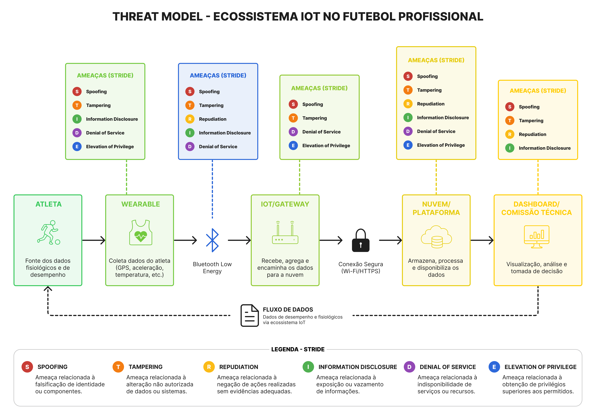
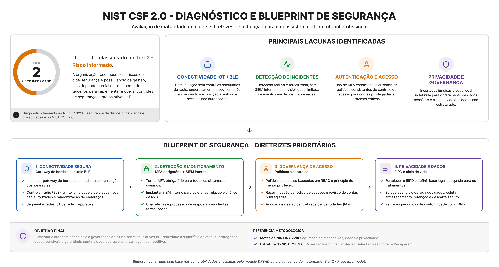

# Riscos Cibernéticos em Dispositivos Vestíveis e Ecossistemas IoT no Futebol Profissional

> Trabalho de Conclusão de Curso (TCC) desenvolvido no curso de Ciência da Computação da PUCRS.

Este projeto apresenta um diagnóstico de segurança cibernética aplicado ao
ecossistema de dispositivos vestíveis (*wearables*) utilizado no futebol
profissional.

O estudo investiga os principais riscos associados à utilização de tecnologias
IoT, realiza a modelagem de ameaças utilizando a taxonomia STRIDE, avalia as
vulnerabilidades por meio do modelo DREAD e analisa a maturidade de segurança
com base no NIST Cybersecurity Framework (CSF) 2.0.

---

## Sobre o projeto

Clubes de futebol profissionais utilizam sensores vestíveis, redes corporais
sem fio (WBAN) e plataformas em nuvem para monitorar indicadores físicos e
fisiológicos dos atletas.

Embora essas tecnologias contribuam para a otimização do desempenho esportivo,
elas também ampliam a superfície de ataque cibernético, introduzindo riscos
relacionados à confidencialidade, integridade e disponibilidade das informações,
além de desafios relacionados à proteção de dados e à conformidade regulatória.

Este trabalho propõe uma abordagem para identificar, modelar e priorizar os
principais riscos presentes nesse ecossistema, além de apresentar diretrizes
técnicas e organizacionais para sua mitigação.

---

## Objetivos

- Identificar vulnerabilidades em ecossistemas IoT utilizados no futebol
  profissional;
- Mapear ameaças utilizando a metodologia STRIDE;
- Avaliar e priorizar riscos por meio do modelo DREAD;
- Avaliar a maturidade de segurança com base no NIST CSF 2.0;
- Propor diretrizes para evolução da postura de segurança do ecossistema.

---

## Metodologia

A pesquisa foi desenvolvida por meio das seguintes etapas:

1. Revisão bibliográfica;
2. Estudo de caso em um clube de futebol profissional;
3. Aplicação de questionário baseado no NIST IR 8228;
4. Identificação das vulnerabilidades;
5. Modelagem de ameaças utilizando STRIDE;
6. Avaliação de riscos utilizando DREAD;
7. Avaliação de maturidade utilizando o NIST CSF 2.0;
8. Elaboração de um *security blueprint* com diretrizes de mitigação.

### Fluxo metodológico


---

## Arquitetura do ecossistema

O estudo considera o fluxo de dados entre os principais componentes do
ecossistema IoT:

**Atleta → Wearable → Bluetooth Low Energy → IoT/Gateway → Nuvem/Plataforma → Dashboard**


---

## Modelagem de ameaças

A modelagem de ameaças utiliza a taxonomia **STRIDE**, considerando as
diferentes superfícies e componentes do ecossistema IoT analisado.

As categorias utilizadas são:

- **Spoofing**
- **Tampering**
- **Repudiation**
- **Information Disclosure**
- **Denial of Service**
- **Elevation of Privilege**

O modelo completo e sua interpretação estão documentados em
[`artifacts/threat-model.md`](artifacts/threat-model.md).



---

## Avaliação de riscos

As vulnerabilidades identificadas foram avaliadas utilizando o modelo
**DREAD**, considerando cinco critérios:

- **Damage**
- **Reproducibility**
- **Exploitability**
- **Affected Users**
- **Discoverability**

A pontuação DREAD varia de **5 a 15 pontos**:

| Pontuação | Nível de risco |
|---|---|
| 5–7 | Baixo |
| 8–11 | Médio |
| 12–15 | Crítico |

Para complementar a avaliação, foi elaborada uma matriz de risco com os
eixos **Impacto × Probabilidade**, derivados dos critérios DREAD.

O cálculo utilizado para os eixos é:

**Impacto = (Dano + Afetados) / 2**

**Probabilidade = (Reprodutibilidade + Explorabilidade) / 2**

Os valores são normalizados para uma escala de **1 a 4** para representação
na matriz.

A metodologia de cálculo e os resultados completos estão documentados em
[`artifacts/risk-assessment.md`](artifacts/risk-assessment.md).


---

## NIST CSF e Security Blueprint

A análise de maturidade foi realizada utilizando o **NIST Cybersecurity
Framework (CSF) 2.0**, complementado pelo **NIST IR 8228** para o contexto
de dispositivos IoT.

A organização analisada foi classificada no:

> **Tier 2 — Risk Informed**

O diagnóstico indica reconhecimento dos riscos de segurança, porém com
limitações relacionadas à autonomia técnica e à dependência de terceiros
para determinados controles e serviços.

A partir dos riscos identificados e do diagnóstico de maturidade, foi
elaborado um *Security Blueprint* com diretrizes para fortalecimento da
segurança do ecossistema.



A descrição do diagnóstico e das diretrizes propostas está disponível em
[`artifacts/security-blueprint.md`](artifacts/security-blueprint.md).

---

## Principais resultados

Entre os principais riscos identificados estão:

- Exposição a ataques de *sniffing* por meio de Bluetooth Low Energy (BLE);
- Dependência de terceiros para monitoramento e detecção de incidentes;
- Utilização condicional de autenticação multifator (MFA);
- Baixa visibilidade sobre determinados dispositivos e componentes IoT;
- Desafios relacionados à governança e proteção dos dados dos atletas.

A análise DREAD resultou nas seguintes pontuações:

| Vulnerabilidade | DREAD | Classificação |
|---|---:|---|
| V1 — Exposição a *sniffing* por falta de controle BLE | 10 | Médio |
| V2 — Detecção de incidentes reativa e terceirizada | 10 | Médio |
| V3 — Fragilidade na autenticação por MFA condicional | 11 | Médio |
| V4 — Incerteza jurídica na base legal adotada | 9 | Médio |
| V5 — Opacidade na conectividade e perda de governança técnica | 11 | Médio |

---

## Frameworks e referências

- **NIST Cybersecurity Framework 2.0**
- **NIST IR 8228**
- **STRIDE**
- **DREAD**
- **LGPD**
- **GDPR**
- **Bluetooth Low Energy (BLE)**
- **Wireless Body Area Networks (WBAN)**
- **Internet of Things (IoT)**

---

## Estrutura do repositório

```text
football-iot-cybersecurity/
│
├── README.md
│
├── artifacts/
│   ├── risk-assessment.md
│   ├── security-blueprint.md
│   └── threat-model.md
│
├── docs/
│   ├── Apresentação.pdf
│   ├── Questionário.pdf
│   └── Riscos Cibernéticos em Dispositivos Vestíveis e Ecossistemas IoT
│       no Futebol Profissional.pdf
│
└── images/
    ├── architecture.png
    ├── methodology.png
    ├── risk_matrix.png
    ├── security_blueprint.png
    └── threat_model.png
```

---

## Artefatos

Os arquivos presentes em `artifacts/` apresentam uma descrição técnica resumida dos principais artefatos produzidos durante o desenvolvimento do TCC:

| Artefato | Descrição |
|---|---|
| [`risk-assessment.md`](artifacts/risk-assessment.md) | Metodologia de avaliação DREAD e matriz de risco |
| [`threat-model.md`](artifacts/threat-model.md) | Modelagem de ameaças utilizando STRIDE |
| [`security-blueprint.md`](artifacts/security-blueprint.md) | Relação entre diagnóstico NIST CSF e diretrizes de segurança |

---

## Documentação

Os documentos relacionados ao desenvolvimento do trabalho estão disponíveis em [`docs/`](docs/).

- **TCC:** documento completo do Trabalho de Conclusão de Curso;
- **Apresentação:** material utilizado para apresentação do trabalho;
- **Questionário:** instrumento utilizado na avaliação baseada no NIST IR 8228.

---

## Palavras-chave

Cibersegurança • Internet das Coisas • IoT • Wearables • Futebol Profissional • Gestão de Riscos • STRIDE • DREAD • NIST • LGPD

---

## Autora

**Samara Monique Tavares de Souza**

Ciência da Computação — Pontifícia Universidade Católica do Rio Grande do Sul (PUCRS)