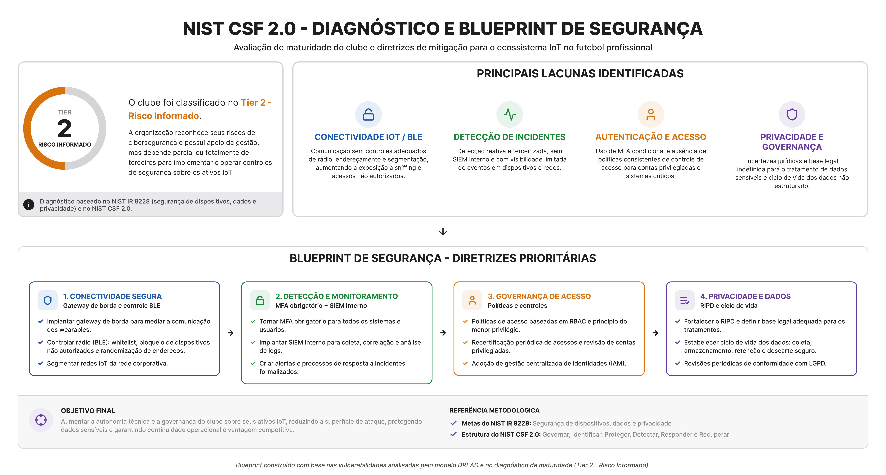

# Security Blueprint — NIST CSF 2.0

Este artefato apresenta a síntese das principais diretrizes de segurança
propostas a partir das vulnerabilidades identificadas, da análise DREAD
e do diagnóstico de maturidade realizado no estudo.

O diagnóstico baseado no **NIST CSF 2.0** classificou o ecossistema
analisado como **Tier 2 — Risco Informado**.

O blueprint organiza as principais diretrizes de mitigação em quatro
frentes:

- **Conectividade segura:** gateway de borda e controles sobre a
  comunicação dos dispositivos;
- **Detecção e monitoramento:** MFA, SIEM e mecanismos de monitoramento;
- **Governança de acesso:** controles de acesso e gestão de identidades;
- **Privacidade e dados:** fortalecimento do RIPD e gestão do ciclo de
  vida dos dados.

A proposta busca aumentar a autonomia técnica e a governança do clube
sobre seus ativos IoT, reduzindo a superfície de ataque e fortalecendo
a proteção dos dados dos atletas.

O artefato relaciona o diagnóstico de maturidade às medidas de segurança
propostas no TCC.

