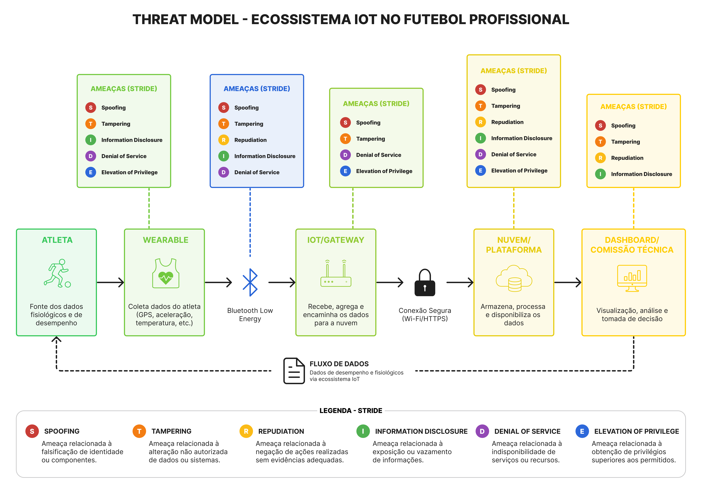

# Threat Model — STRIDE

Este artefato representa o modelo de ameaças desenvolvido para o
ecossistema de dispositivos vestíveis e IoT analisado no TCC.

O fluxo considerado contempla os principais componentes do ecossistema:

**Atleta → Wearable → Bluetooth Low Energy → IoT/Gateway → Nuvem/Plataforma → Dashboard**

A modelagem utiliza a taxonomia **STRIDE** para categorizar as ameaças
associadas aos diferentes componentes e fluxos de dados:

- **S — Spoofing**
- **T — Tampering**
- **R — Repudiation**
- **I — Information Disclosure**
- **D — Denial of Service**
- **E — Elevation of Privilege**

O modelo permite visualizar a superfície tecnológica analisada e serve
como base para a identificação das vulnerabilidades posteriormente
avaliadas pelo modelo DREAD.

